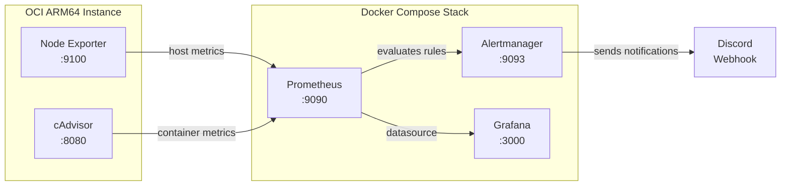

# Cloud Infrastructure Observability & Incident Response

A fully provisioned, self-contained monitoring stack deployed on an Oracle Cloud Infrastructure (OCI) ARM64 instance. Clone it, run `docker compose up -d`, and get dashboards, metrics, and alerting out of the box — no manual configuration required.

## Architecture



## Stack Components

| Service | Image | Port | Purpose |
|---|---|---|---|
| **Prometheus** | `prom/prometheus:v2.51.0` | 9090 | Time-series database, scrapes targets every 15s, evaluates alert rules |
| **Node Exporter** | `prom/node-exporter:v1.7.0` | 9100 | Exposes host-level metrics (CPU, memory, disk, network) from `/proc` and `/sys` |
| **cAdvisor** | `gcr.io/cadvisor/cadvisor:v0.49.1` | 8080 | Exposes per-container resource usage metrics |
| **Alertmanager** | `prom/alertmanager:v0.27.0` | 9093 | Routes alerts to Discord with grouping, deduplication, and silencing |
| **Grafana** | `grafana/grafana:10.4.0` | 3000 | Visualization layer with pre-provisioned Node Exporter Full dashboard |

## Quick Start

```bash
# 1. Clone the repo
git clone https://github.com/<your-username>/monitoring.git
cd monitoring

# 2. Create your environment file
cp .env.example .env
# Edit .env with your Grafana password and Discord webhook URL

# 3. Start the stack
make up

# 4. Check everything is healthy
make status
```

**Access the services:**
- Grafana: http://127.0.0.1:3000 (login with credentials from `.env`)
- Prometheus: http://127.0.0.1:9090
- Alertmanager: http://127.0.0.1:9093

## Alert Rules

All alert rules are defined in [`prometheus/alert_rules.yml`](prometheus/alert_rules.yml) and evaluated by Prometheus.

| Alert | Expression | For | Severity |
|---|---|---|---|
| HighCpuUsage | CPU > 80% | 1m | warning |
| CriticalCpuUsage | CPU > 95% | 1m | critical |
| HighMemoryUsage | Memory > 85% | 2m | warning |
| DiskSpaceLow | Disk > 80% | 5m | warning |
| DiskSpaceCritical | Disk > 90% | 2m | critical |
| InstanceDown | Target unreachable | 30s | critical |
| ContainerKilled | Container missing > 60s | 0m | warning |
| ContainerHighCpu | Container CPU > 80% | 2m | warning |

When an alert fires, Alertmanager routes it to Discord with a formatted notification card.

## Validate & Test

```bash
# Validate Prometheus config and alert rules
make validate

# Run a smoke test — generates CPU load and checks if the alert pipeline fires
make test-alert
```

## Available Make Commands

```
make help              Show all available commands
make up                Start the full monitoring stack
make down              Stop the full monitoring stack
make restart           Restart all services
make logs              Tail logs from all services
make status            Show health status of all services
make clean             Stop stack and remove all data volumes
make test-alert        Run alert pipeline smoke test
make reload-prometheus Hot-reload Prometheus config
make validate          Validate Prometheus config and rules
```

## OCI Keep-Alive

Oracle may reclaim idle Always-Free instances. The [`scripts/keepalive.sh`](scripts/keepalive.sh) script generates a brief CPU load (25% for 30 min) to prevent this.

**Set up the cron job:**
```bash
# Run every 3 hours
crontab -e
# Add: 0 */3 * * * /home/ubuntu/monitoring/scripts/keepalive.sh >> /var/log/keepalive.log 2>&1
```

## Project Structure

```
monitoring/
├── docker-compose.yml              # All services defined here
├── prometheus/
│   ├── prometheus.yml              # Scrape config and Alertmanager target
│   └── alert_rules.yml             # PromQL alerting rules
├── alertmanager/
│   └── alertmanager.yml            # Alert routing and Discord webhook
├── grafana/
│   └── provisioning/
│       ├── datasources/
│       │   └── prometheus.yml      # Auto-configures Prometheus datasource
│       └── dashboards/
│           ├── dashboard.yml       # Dashboard provider config
│           └── json/
│               └── node-exporter-full.json  # Dashboard 1860
├── scripts/
│   ├── test-alert.sh               # Alert pipeline smoke test
│   └── keepalive.sh                # OCI instance keep-alive
├── docs/
│   ├── decisions.md                # Technical decision log
│   └── incident-response.md        # Alert response runbook
├── .env.example                    # Environment variable template
├── Makefile                        # Developer-friendly commands
└── README.md
```

## Documentation

- [**Decision Log**](docs/decisions.md) — Why Prometheus over InfluxDB, why 15s scrape interval, why pinned versions, etc.
- [**Incident Response Runbook**](docs/incident-response.md) — Step-by-step procedures for every alert type.

## Host Platform

- **Cloud:** Oracle Cloud Infrastructure (OCI) Always-Free Tier
- **Instance:** Ampere A1 (ARM64), Ubuntu 24.04 LTS
- **Reverse Proxy:** Nginx/Caddy with TLS (not included in this repo)
